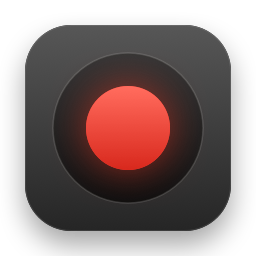
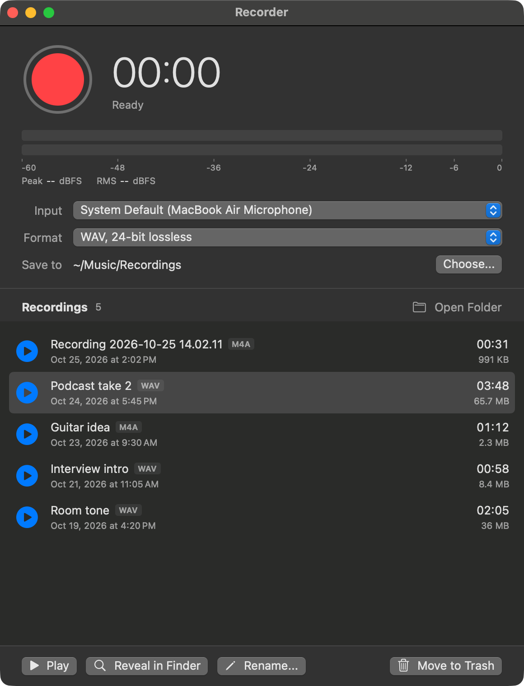
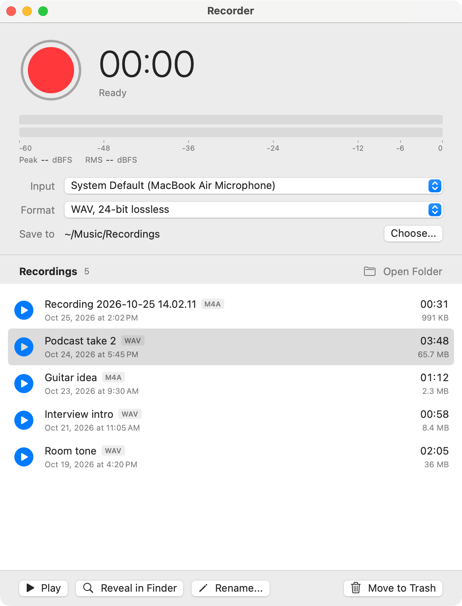
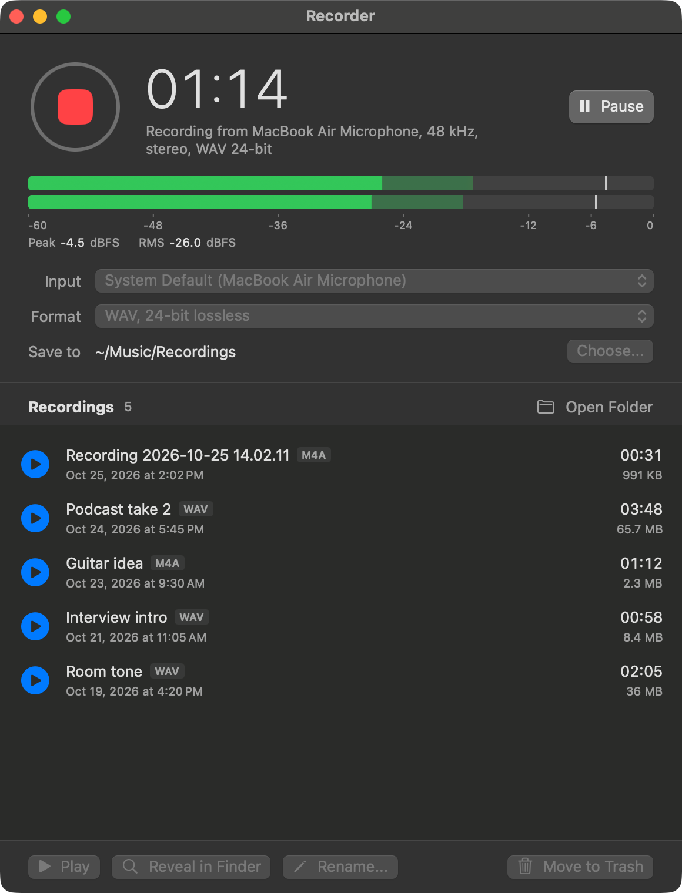
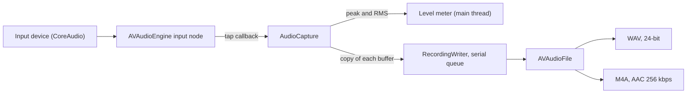

<p align="center">
  
</p>

<h1 align="center">Recorder</h1>

<p align="center">
  A small native macOS app that records audio from any input device and keeps a list of the recordings.
</p>

<p align="center">
  
  
  <a href="LICENSE"></a>
</p>

<p align="center">
  
</p>

<table>
  <tr>
    <th align="center">Light appearance</th>
    <th align="center">During a recording</th>
  </tr>
  <tr>
    <td></td>
    <td></td>
  </tr>
</table>

The names and recordings in the screenshots are made up.

## Features

- Record and stop with the red button or the space bar. Pause and resume while recording.
- Elapsed time as `mm:ss` (`h:mm:ss` from one hour on) and a live level meter in dBFS, one bar per channel.
- Lossless 24-bit WAV or AAC M4A, at the sample rate of the input device. Nothing is resampled.
- Any input device that macOS lists. The device list updates when a device is plugged in or removed.
- A list of the recordings in the save folder, newest first, with duration and size. Play, reveal in Finder, rename, move to Trash, or drag a file out to Finder or another app.
- The save folder is yours to choose. The default is `~/Music/Recordings`.
- A recording that is cut short (device unplugged, disk full, no audio arriving) is closed and kept. The window says what happened.
- The Mac does not go to idle sleep during a recording.
- Follows the system light or dark appearance.
- No network access, no account, no telemetry. See [Privacy](#privacy).

## Requirements

- macOS 13 (Ventura) or later.
- To build: the Xcode Command Line Tools. Xcode itself is not needed.
- A microphone or another audio input.

Recorder is built with Swift 5.8.1 and the macOS 13.3 SDK from the Command Line Tools. See [Known limitations](#known-limitations) for what has been tested.

## Installation

There is no prebuilt download. The app builds from source in a few seconds.

```
xcode-select --install     # once, if the Command Line Tools are not installed
git clone https://github.com/SaschaKubisch/audio-recorder.git
cd audio-recorder
bash build.sh --install
```

`--install` copies the app to `~/Applications/Recorder.app`, replacing an existing copy and quitting it first if it is running. Start it from Finder or Spotlight.

Build options:

| Command | Result |
| --- | --- |
| `bash build.sh` | `build/Recorder.app` for the Mac you run it on |
| `bash build.sh --universal` | `build/Recorder.app` for Apple Silicon and Intel (arm64 and x86_64, joined with `lipo`) |
| `bash build.sh --install` | Build, then install to `~/Applications` |

The options can be combined: `bash build.sh --universal --install`.

The app is signed ad hoc (`codesign --sign -`) and is not notarized. macOS treats every rebuild as a new app for privacy purposes, so it may ask for microphone access again after each rebuild.

To remove the app, delete `~/Applications/Recorder.app`. Its settings are in the preferences domain `io.github.saschakubisch.recorder`; `defaults delete io.github.saschakubisch.recorder` clears them. Your recordings are not touched.

## Usage

### Recording

Press the red button, the space bar, or Cmd-R. The first time, macOS asks for microphone access. If access was denied, the window explains this and has a button that opens System Settings, Privacy & Security, Microphone.

While recording, the button turns into a stop square, the time counts up, and a Pause button appears. While paused, the meter keeps moving but nothing is written to the file, and the elapsed time stands still. Input, format and folder cannot be changed during a recording.

The meter shows the level of up to two channels from -60 to 0 dBFS. The solid bar is the RMS level, the lighter bar is the peak, and the thin line is the peak hold. The numbers below give the peak and RMS in dBFS. A red CLIP mark appears when a sample reaches full scale; click it to clear it. The meter runs only while recording.

Stopping, quitting the app, or closing the window ends the recording and closes the file. Closing the window quits the app.

### Keyboard shortcuts

| Keys | Action |
| --- | --- |
| Space | Start or stop recording |
| Cmd-R | Start or stop recording (menu Recording) |
| Option-Cmd-P | Pause or resume (menu Recording) |
| Shift-Cmd-O | Show the recordings folder in Finder (menu Recording) |
| Return, Esc | Confirm or cancel in the rename sheet |

### Formats

| Format | Codec | Size, 48 kHz stereo | Channels |
| --- | --- | --- | --- |
| WAV, 24-bit lossless | Linear PCM, 24-bit integer | about 17 MB per minute | mono or stereo |
| M4A, AAC 256 kbps | AAC, constant 256 kbps | about 1.9 MB per minute | mono or stereo |

Both formats use the sample rate of the input device, usually 44.1 or 48 kHz. A device with one input gives a mono file. A device with two or more inputs gives a stereo file made from its first two channels.

If the sample rate of the input changes during a recording, the recording stops and the file is kept.

### Folder and file names

The row "Save to" shows where recordings go. "Choose..." opens a folder picker. The list below shows the files of that folder and updates when the folder changes.

New files are named `Recording YYYY-MM-DD HH.mm.ss.wav` (or `.m4a`). If that name is taken, a counter is added. The folder is created when needed.

The choice is stored as a plain path in the app's preferences, domain `io.github.saschakubisch.recorder`, key `recordingsFolderPath`. If the stored folder no longer exists at launch, the app uses `~/Music/Recordings` and says so under the row. From a shell:

```
defaults write io.github.saschakubisch.recorder recordingsFolderPath /path/to/folder   # set
defaults delete io.github.saschakubisch.recorder recordingsFolderPath                  # back to the default
```

Two more keys are stored: `inputDeviceUID` (the chosen input; empty means System Default) and `recordingFormat` (`wav24` or `m4a`).

### The recordings list

The list shows the audio files in the save folder, not in its subfolders. It recognizes the extensions wav, m4a, aiff, aif, caf, mp3 and flac. Select a row and use the buttons below the list, or use the play button in the row, a double click, or the right-click menu:

- Play and stop. While a file plays, its row shows the playback position.
- Reveal in Finder.
- Rename. The extension stays. A name cannot be empty, contain `/` or `:`, start with a dot, or match an existing file.
- Move to Trash. The file goes to the Trash; nothing is deleted permanently.
- Drag a row into Finder or another app to copy the file there.

The file that is being recorded does not appear in the list until it is finished.

## Privacy

- The app uses the microphone, through the standard macOS permission. The text of the permission dialog is in `Info.plist`.
- It reads and writes the folder you choose: it lists the audio files there, reads their duration, writes new recordings, and renames files or moves them to the Trash when you ask.
- Its preferences hold the folder, the input device, the format and the window position.
- It makes no network connections. The sources contain no networking code. The only `URL(string:)` call opens the System Settings page for the microphone (`x-apple.systempreferences:`). To check:

  ```
  grep -rnE 'URLSession|NWConnection|CFNetwork|WebKit|NSURLConnection|import Network' Sources   # no output
  grep -rn 'URL(string' Sources                                                              # one line, the Settings link
  ```

- It has no telemetry, crash reporting or update check.
- It is not sandboxed. It runs with the rights of your user account.

## How it works

Source files in `Sources/`:

| File | Role |
| --- | --- |
| `RecorderApp.swift` | Entry point, window, the Recording menu, and the command-line options (`--self-test`, `--snapshot`, `--appearance`) |
| `ContentView.swift` | Top part of the window: record button, time, meter, input, format and folder rows, permission and notice banners |
| `RecorderModel.swift` | State of the recorder: permission, device list, start, pause and stop, the timer |
| `AudioCapture.swift` | Captures from the chosen device with `AVAudioEngine`, measures levels, watches for device loss and stalled input |
| `AudioDevices.swift` | Lists input devices and the default input with CoreAudio, and listens for changes |
| `RecordingWriter.swift` | The two file formats, file names, the writer with its serial queue, and the level calculation |
| `RecordingFolder.swift` | The save-folder setting and its fallback |
| `LevelMeterModel.swift` | Meter values in dBFS with decay, peak hold and clip flag; time formatting |
| `LevelMeterView.swift` | Draws the meter |
| `LibraryModel.swift` | Lists the folder, watches it for changes, plays files with `AVAudioPlayer`, renames, reveals and trashes |
| `LibraryView.swift` | The recordings list, its rows, the action bar and the rename sheet |
| `SelfTest.swift` | The headless check behind `--self-test` |

The audio path:



The tap callback copies each buffer into the writer and returns at once. Disk and encoder work happen on the writer's own serial queue, so they do not block the audio thread or the main thread, and no buffers are dropped. The file is created from the first real buffer, so its sample rate and channel count are those of the data that arrives. While paused, buffers are measured for the meter but not handed to the writer.

The recording stops, and the file is closed and kept, if the input device is disconnected, the sample rate of the input changes, the audio engine cannot restart after a system audio change, no audio arrives for 4 seconds, or a write fails.

## Development

```
bash build.sh                       # build for this Mac
bash build.sh --universal           # arm64 and x86_64
```

**Self-test.** It needs no microphone and shows no window.

```
d=$(mktemp -d) && build/Recorder.app/Contents/MacOS/Recorder --self-test "$d"
```

It pushes a 2 second 1 kHz sine through the same `RecordingWriter` the recorder uses, for WAV and for M4A, and reads the files back. It checks sample rate, channel count, 24-bit format, AAC format, length, level and tone frequency. It also checks a mono 44.1 kHz file, a 4-channel 96 kHz source reduced to two channels, the level calculation, file naming, the recordings list, the rename rules and the folder setting. It prints PASS or FAIL for each check, ends with `SELF-TEST PASSED`, and exits 0 only if all checks pass. The files it writes stay in the folder you give.

**Snapshot.** The app can write a picture of its own window and quit:

```
open -n -W build/Recorder.app --args --snapshot /path/to/window.png --appearance dark
```

The picture is written two seconds after launch. `--appearance light|dark` forces the look for that run. No Screen Recording permission is needed, because the app captures only its own window. The picture has the pixel density of the display the window is on: 2x on a Retina display, 1x on a standard display.

**Icon.** `bash build.sh` compiles `scripts/make-icon.swift`, which draws the icon and writes `build/AppIcon.iconset`. `iconutil` turns that into `AppIcon.icns`. `docs/icon.png` is `build/AppIcon.iconset/icon_128x128@2x.png` (256 pixels, shown at 128 in this file).

**Screenshots.** The files in `docs/screenshots/` were written with `--snapshot` on a 2x display. The two idle screenshots show five generated sample files in `~/Music/Recordings` (tones with fictional names, converted with `afconvert`) and one selected row. `recording.png` comes from a throwaway build that sets the recorder to the recording state and feeds a synthetic signal into the real level meter. Every control in it is drawn by the real views. That build is not part of this repository.

## Known limitations

- The meter runs only while recording. There is no input monitoring before you press record.
- If the app or the Mac crashes during a recording, the file is not finalized and may be unreadable. A normal stop, a quit, a device loss and a write error all finalize it.
- Recordings from devices with more than two inputs keep only the first two channels.
- Playback has no seek bar.
- The interface is in English only.
- Tested on macOS 26 with Apple Silicon. The x86_64 part of the universal build passes `--self-test` under Rosetta; it has not been run on an Intel Mac. The deployment target is macOS 13; versions 13 to 25 have not been tested.

## Contributing

Issues and pull requests are welcome. Before a pull request, run `bash build.sh` and the self-test (see [Development](#development)). Both must succeed. Keep changes small and in the style of the existing code, and start each new Swift file with `// SPDX-License-Identifier: MIT`.

## License

MIT. See [LICENSE](LICENSE). Copyright (c) 2026 Sascha Kubisch.
